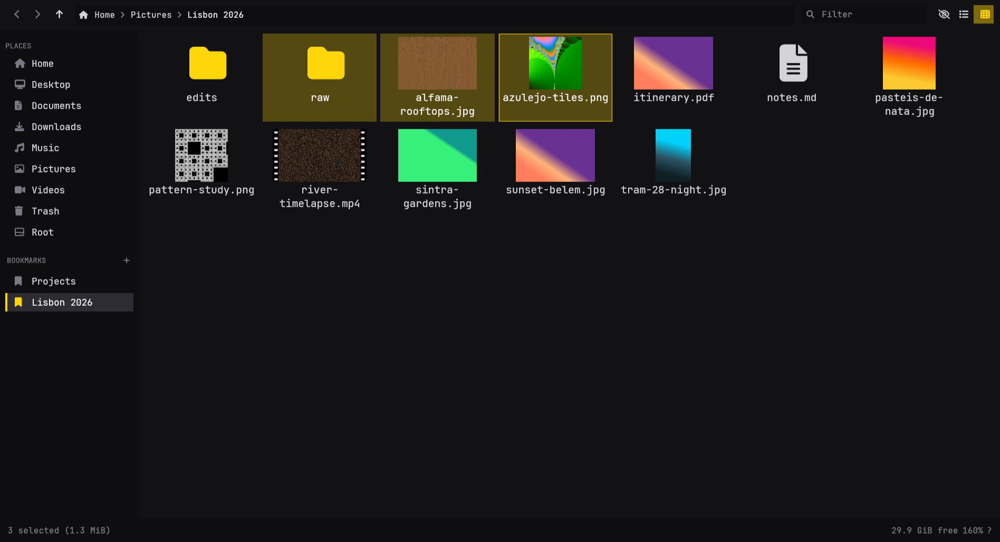
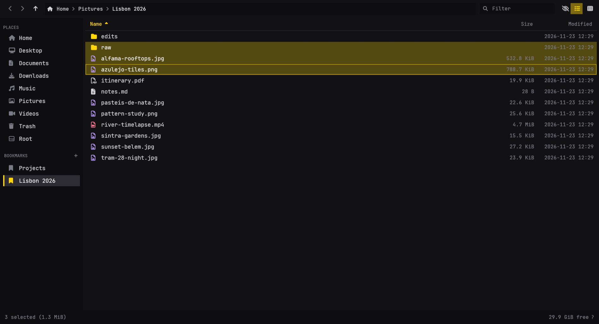

<div align="center">


# Ferry

**A fast, keyboard-first file manager for [Omarchy](https://omarchy.org) that follows your theme live.**

In the spirit of Dolphin, written in Rust, and at home on Hyprland.

[](https://github.com/yojahny55/ferry/actions/workflows/ci.yml)
[](https://github.com/yojahny55/ferry/releases/latest)
[](LICENSE)




</div>

## Why Ferry

Omarchy's look is consistent until you open a file manager. Ferry takes its whole palette from
the current Omarchy theme, not just the accent, and changes with it the moment you switch
themes. Corners follow Hyprland's rounding, text uses your Omarchy font, and the window speaks
the language you picked in Omarchy's setup.

It is also built to stay out of your way: every action has a key, folders load in the
background so a sleeping NAS never freezes the window, and the app starts instantly.

## Features

- **Follows the desktop, live**: the whole Omarchy palette (light themes too), window rounding,
  font, language, the desktop's text size (GTK's text scaling, so Ferry matches your other apps
  on high-resolution screens), and Omarchy's window opacity: when windows are glassy, Ferry is
  see-through like the terminals, with text kept crisp. Secondary text is nudged until it meets
  WCAG AA contrast, since many themes' dark foregrounds are too faint to read.
- **Appearance menu** (the sliders icon) to set size and transparency yourself instead.
- **Details and icons views**, with sortable columns and natural ordering (`photo2` before `photo10`).
- **Zoom** with Ctrl+wheel or Ctrl+±, kept separately for each view and remembered.
- **Previews** of images, videos, PDFs and office files, read from and written to the shared
  freedesktop thumbnail cache, so previews other apps already made appear instantly.
- **Bookmarks** you can drag folders onto or add with **+**, shared with GTK's bookmarks, so
  they also show up in the desktop's file pickers.
- **Fast search below any folder**, by name or inside files (Ctrl+Shift+F). It uses the
  same engine as ripgrep and fd: every core walks the folders, `.gitignore`d and hidden files are
  skipped unless you ask, binary files are never read, and results stream in as they're found.
  Names match fuzzily and are ranked like fzf (with Helix's
  [nucleo](https://github.com/helix-editor/nucleo)), so `trp plan` finds `trips/lisbon/plan.md`.
  A contents match opens the file at that line. No indexer runs in the background.
- **A built-in text editor** for notes, Markdown, code and config files: syntax highlighting in
  your theme's colors, find (Ctrl+F), a rendered Markdown preview (Ctrl+E), line numbers, and
  undo. Ctrl+S saves, Esc goes back. Saving is atomic, keeps file permissions, and won't
  overwrite changes another program made in the meantime. Images, videos and documents still
  open in your default apps.
- **Drives and network shares**, told apart: USB drives and disk images under *Devices*, with
  a bar showing how full they are, an eject button, and *Mount*, *Unmount* and *Format…* (exFAT,
  FAT32, ext4, NTFS) in their menu, all through UDisks like GNOME and KDE. NFS, SMB and SSHFS
  shares from `/etc/fstab` or `/proc/mounts` go under *Network*, and are never touched until
  opened, so a sleeping NAS never stalls the sidebar.
- **Drag files out** into other apps (a browser, a chat, another file manager) through native Wayland drag-and-drop.
- **Safe file operations**: paste never overwrites (`name (1).ext`), Delete moves to the trash,
  and only Shift+Delete deletes, after asking.
- **Never blocks on slow disks**: folder loading and change checks run in the background, so an
  unreachable network mount shows *Loading…* instead of freezing the window.
- **Type to jump** to a name, filter as you type, and edit the path directly.
- Copy and paste interoperate with the terminal: copied files go to the clipboard as paths, and pasted paths become files.

<details>
<summary>Details view</summary>



</details>

## Install

Ferry targets Omarchy and other Arch-based Hyprland desktops. It needs a Wayland session for
dragging files out; the rest also builds for X11, but that path is untested.

### From a release

Download the latest `ferry-*-x86_64-linux.tar.gz` from
[Releases](https://github.com/yojahny55/ferry/releases/latest), then:

```sh
tar xf ferry-*-x86_64-linux.tar.gz
cd ferry-*-x86_64-linux
sudo install -Dm755 ferry /usr/local/bin/ferry
sudo install -Dm644 ferry.desktop /usr/local/share/applications/ferry.desktop
sudo install -Dm644 ferry.svg /usr/local/share/icons/hicolor/scalable/apps/ferry.svg
```

### From source (Arch / Omarchy)

```sh
git clone https://github.com/yojahny55/ferry
cd ferry
bin/install        # builds a pacman package with makepkg and installs it
```

This puts Ferry in the app launcher (Super + Space). Building needs Rust 1.95 or newer
(`sudo pacman -S rust`).

### Make it the default

```sh
xdg-mime default ferry.desktop inode/directory
```

To open it with Super+E on Omarchy, add this to `~/.config/hypr/bindings.lua`:

```lua
o.bind("SUPER + E", "File manager", { launch = "ferry" })
```

### Runtime dependencies

Ferry uses tools Omarchy already ships: `gio` (trash), `xdg-open` (opening files),
`coreutils` (`cp`, `mv`), `lsblk`, and `udisksctl` and `gdbus` (mounting, ejecting and
formatting drives through UDisks; formatting asks for your password through the desktop's
polkit agent). Formatting offers the filesystems whose `mkfs` is installed (`exfatprogs`,
`dosfstools`, `e2fsprogs`, `ntfs-3g`). Optional: `xdg-terminal-exec` for *Open Terminal Here*, and the
thumbnailers in `/usr/share/thumbnailers` (glycin, ffmpegthumbnailer, papers…) for previews.

## Keyboard shortcuts

Press `?` in the app for this list.

| Key | Action |
| --- | --- |
| Enter / Space | Open |
| Backspace / Alt+Left | Back |
| Alt+Right | Forward |
| Alt+Up | Parent folder |
| Alt+Home | Home folder |
| Ctrl+L | Edit the path |
| Ctrl+F | Filter this folder |
| Ctrl+Shift+F | Search in subfolders (Tab switches names / contents, Alt+Enter shows a result in its folder) |
| a–z | Jump to a name |
| Ctrl+C / Ctrl+X / Ctrl+V | Copy, cut, paste |
| Ctrl+Alt+C | Copy path |
| F2 | Rename |
| Del | Move to trash |
| Shift+Del | Delete permanently |
| Ctrl+Shift+N | New folder |
| Ctrl+Alt+N | New text file |
| Ctrl+D | Bookmark the selected folders, or this one |
| Ctrl+A | Select all |
| Ctrl+H | Show hidden files |
| Ctrl+1 / Ctrl+2 | Details or icons |
| Ctrl+Wheel, Ctrl++ / Ctrl+- | Zoom the current view |
| Ctrl+0 | Reset zoom |
| F4 | Open a terminal here |
| F5 | Refresh |
| ? | Keyboard shortcuts |
| Ctrl+S | Save (text editor) |
| Esc / Ctrl+W | Close the text editor |
| Ctrl+F, Enter / Shift+Enter, F3 | Find in the text editor, next / previous match |
| Ctrl+E | Markdown preview or source |
| Ctrl+Q | Quit (asks first if there are unsaved changes) |

## Files Ferry reads and writes

| Path | What for |
| --- | --- |
| `~/.local/state/omarchy/current/theme/colors.toml` | Theme palette (read; Omarchy's yellow accent when absent) |
| `~/.config/omarchy/language` | Interface language (read) |
| `~/.local/state/omarchy/toggles/hypr/window-glassy.lua` | Whether Omarchy's windows are glassy (looked for) |
| GNOME's `text-scaling-factor` (via `gsettings`) | Text size (read) |
| `~/.config/gtk-3.0/bookmarks` | Bookmarks, shared with GTK apps (read and written; other entries are kept as they are) |
| `~/.cache/thumbnails/` | Shared preview cache, per the freedesktop spec (read and written) |
| `~/.config/ferry/settings.json` | View, zoom, sorting, hidden files, size and transparency when set by hand (written) |
| `/proc/mounts`, `/etc/fstab` | Mounted drives and network shares (read) |

Ferry never changes Omarchy's or Hyprland's configuration.

## Languages

English and Spanish ship today, following Omarchy's language setting. Adding a language is a
single JSON file; see [CONTRIBUTING.md](CONTRIBUTING.md#translations).

## Known limitations

- Dropping files *into* Ferry from other apps isn't supported yet.
- No tabs, split view, or undo yet.
- Right-to-left languages aren't laid out right to left yet.
- *Open with…* (choosing among apps) and file properties aren't there yet.
- The text editor has no replace or go-to-line yet, edits files up to 5 MiB, and highlights
  files up to 256 KiB. Links in the Markdown preview aren't clickable, and images show their
  description.
- Search reads the disk each time rather than keeping an index, so a contents search of a whole
  home folder takes about a second; files over 50 MiB aren't searched inside.

See the [issues](https://github.com/yojahny55/ferry/issues) for what's planned, and feel free to
open one for what you'd like.

## Troubleshooting

Run Ferry from a terminal with `FERRY_DEBUG=1 ferry` to log drags, thumbnails and settings.
Please include that output when you [report a bug](https://github.com/yojahny55/ferry/issues/new/choose).

## Contributing

Contributions are welcome: bug reports, translations, and code. Start with
[CONTRIBUTING.md](CONTRIBUTING.md). Everyone taking part is expected to follow the
[Code of Conduct](CODE_OF_CONDUCT.md). To report a security problem, see [SECURITY.md](SECURITY.md).

## Credits

- Built with [egui](https://github.com/emilk/egui) and [eframe](https://github.com/emilk/egui/tree/main/crates/eframe).
- Search uses [ripgrep](https://github.com/BurntSushi/ripgrep)'s `ignore` and `grep` crates and
  [nucleo](https://github.com/helix-editor/nucleo); the editor uses
  [syntect](https://github.com/trishume/syntect) and [pulldown-cmark](https://github.com/pulldown-cmark/pulldown-cmark).
- Theme following is modeled on Omarchy's own apps, such as [Omacut](https://github.com/omacom-io/omacut) (MIT, David Heinemeier Hansson).
- Inspired by KDE's [Dolphin](https://apps.kde.org/dolphin/).

## License

[MIT](LICENSE) © Yojahny Chavez
